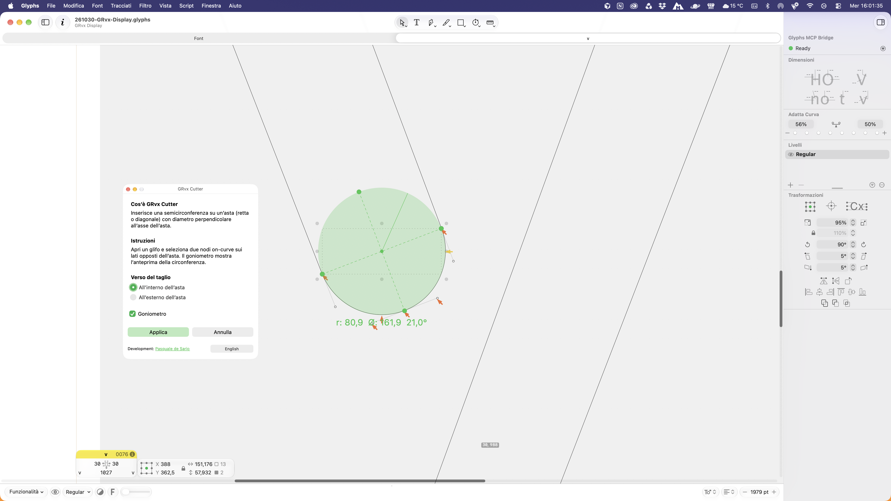

# GV Scripts

> **WIP** — early tools; APIs and behaviour may still change.

Open-source [Glyphs](https://glyphsapp.com) scripts (prefix **GV-**).




## Scripts

| Script | Menu | What it does |
|---|---|---|
| **GV-Pill Cut** | Script → GV → GV-Pill Cut | Cuts a geometric semicircle into a stem (straight or diagonal). |
| **GV-Soft Landing** | Script → GV → GV-Soft Landing | Soft-lands a cubic into a straight (auto minimal G1; may slide the junction). |

## Requirements

- [Glyphs](https://glyphsapp.com) 3/4
- [Vanilla](https://github.com/robotools/vanilla) (for the floating panels; without it each script still runs a default one-shot action)


## Install

1. Download or clone this repository.
2. Copy the `GV` folder into your Glyphs Scripts directory:

   - **Glyphs 4:** `~/Library/Application Support/Glyphs 4/Scripts/`
   - **Glyphs 3:** `~/Library/Application Support/Glyphs/Scripts/`

3. In Glyphs: **Script → Reload Scripts** (or restart Glyphs).


## Usage — GV-Pill Cut

1. Open a glyph in Edit View.
2. Select **exactly two on-curve nodes** on opposite sides of the stem (the ends of the cut diameter).
3. The **goniometer** preview shows the circle (toggle in the panel).
4. Choose cut direction: **inside** or **outside** the stem.
5. Click **Apply**.

The diameter is aligned perpendicular to the stem axis when the stem can be recognized.

### Known limits (Pill Cut)

- The span between the two nodes must be short (at most 14 intermediate nodes); select the diameter ends, not a long outline arc.
- Stem detection needs roughly parallel edges at the two nodes; nodes on the **same** edge are rejected.
- Very small radii are rejected.
- Both nodes must belong to the **same** path.
- Goniometer canvas status strings are currently Italian-only; the panel UI is fully bilingual.


## Usage — GV-Soft Landing

1. Open a glyph in Edit View.
2. Select the **on-curve junction** where a cubic meets a straight segment (or both ends of that cubic).
3. Preview shows the automatic proposal (handles + optional junction slide along the straight).
4. Click **Apply**.

Stays in PostScript cubics. Finds a small G1 landing edit; slides the junction along the straight only when that better preserves the curve.

### Known limits (Soft Landing)

- Only cubic (`CURVE`) ↔ `LINE` junctions; TrueType `qcurve` chains are not rewritten.
- Junction slide stays on the straight axis and never collapses the remaining line segment.
- Soft flatten is capped; full G2 crush of the bowl is avoided.


## Development

```text
GRvx-Cutter/
├── GV/
│   ├── GV-Pill Cut.py        # MenuTitle: GV-Pill Cut
│   └── GV-Soft Landing.py    # MenuTitle: GV-Soft Landing
├── docs/
│   └── preview.png
├── tests/
│   ├── test_choose_span.py
│   └── test_soft_landing.py
├── LICENSE
└── README.md
```
